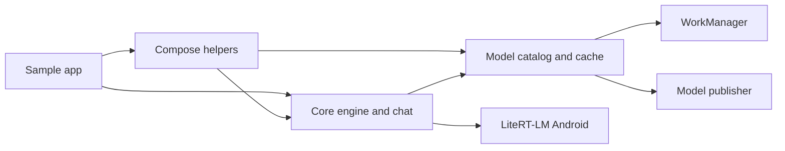

# PocketInferenceKit

[](https://github.com/Avinash-006/PocketInferenceKit/actions/workflows/ci.yml)
[](LICENSE)

PocketInferenceKit is a Kotlin Android SDK for running language models on-device with LiteRT-LM. It handles verified model acquisition, streaming chat, cancellation, and structured tool use so Android apps can add local inference without wiring native execution or model storage themselves.

## Quickstart

Call from a coroutine while your app is visible.

```kotlin
import io.github.avinash006.pocketinferencekit.core.PocketInferenceKit
import io.github.avinash006.pocketinferencekit.models.ModelCatalog

PocketInferenceKit.load(context, ModelCatalog.Qwen3_0_6B).use { engine ->
    engine.newChat(systemPrompt = "You are helpful.").use { chat ->
        chat.sendText("Hello").collect { print(it) }
    }
}
```

## Install

Publish the checkout to its local verification repository with `./gradlew publishAllPublicationsToVerificationRepository -PreleaseVersion=0.1.0`. In your consuming project, add that Maven directory, Google Maven, and Maven Central to `dependencyResolutionManagement.repositories`. [Complete installation steps](docs/GETTING_STARTED.md)

```kotlin
dependencies {
    implementation("io.github.Avinash-006:pocketinferencekit-core:0.1.0")
}
```

Add `pocketinferencekit-compose` for the Compose state and download-progress helpers. The model catalog comes with the core dependency.

## Features

- Kotlin Flow streaming with typed failures, cancellable turns, and configurable history trimming.
- CPU, GPU, and NPU selection with fallback and an observable active backend.
- Verified model downloads, WorkManager resume, Wi-Fi-only transfers, Android document imports, and a private cache.
- Schema-validated tool handlers with bounded continuation.
- Material 3 sample with chat, model management, and clock and arithmetic tools.

## Models and devices

| Catalog entry | File size | Device runtime |
| --- | ---: | --- |
| Qwen3 0.6B INT4 | 343 MB | Android API 24+, ARM64 or x86_64 |
| Qwen3.5 0.8B mixed precision | 487 MB | Android API 24+, ARM64 or x86_64 |
| Qwen2.5 1.5B Instruct INT8 | 1.60 GB | Android API 24+, ARM64 or x86_64 |

The table lists model file sizes and runtime ABI requirements. Accelerator compatibility, RAM, and throughput depend on the device and model. The model pages document the pinned revision, exact size, and license. [Model documentation](docs/MODELS.md) · [Runtime research](docs/RESEARCH.md)

## Architecture



## Sample app

Build or run `:sample` with Android Studio. Select a model, download or resume it, then open a streaming chat or try the tool demo.

**Device recording pending.** The debug and release APKs build. [Device validation and recording](https://github.com/Avinash-006/PocketInferenceKit/issues/9)

## FAQ

**Does chat need an internet connection?** Inference runs on the device after the model is installed. The initial catalog download needs a connection. You can also import a compatible bundle from Android storage.

**How do I stop a response?** Cancel the collecting coroutine. Close the chat or engine when its owner is done. Use `awaitClosed()` when another operation must wait for released resources.

**Why is tokens/sec blank?** The runtime must provide decode statistics. Time to the first visible output is measured independently.

## Development

Use JDK 21, Android SDK Platform 37.2, and Build Tools 36.0.0.

```sh
./gradlew build lint testDebugUnitTest spotlessCheck detekt apiCheck
```

[Design](docs/DESIGN.md) · [Tool calling](docs/TOOL_CALLING.md) · [Troubleshooting](docs/TROUBLESHOOTING.md) · [Roadmap](docs/ROADMAP.md) · [Quality checks](docs/QUALITY.md) · [Releasing](docs/RELEASING.md) · [Contributing](CONTRIBUTING.md)

Licensed under [Apache 2.0](LICENSE).
